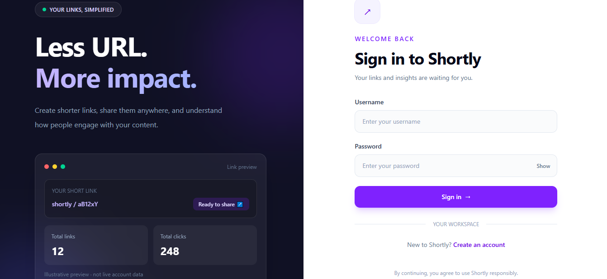
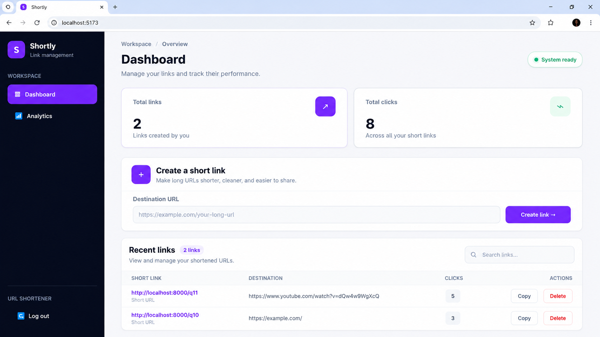
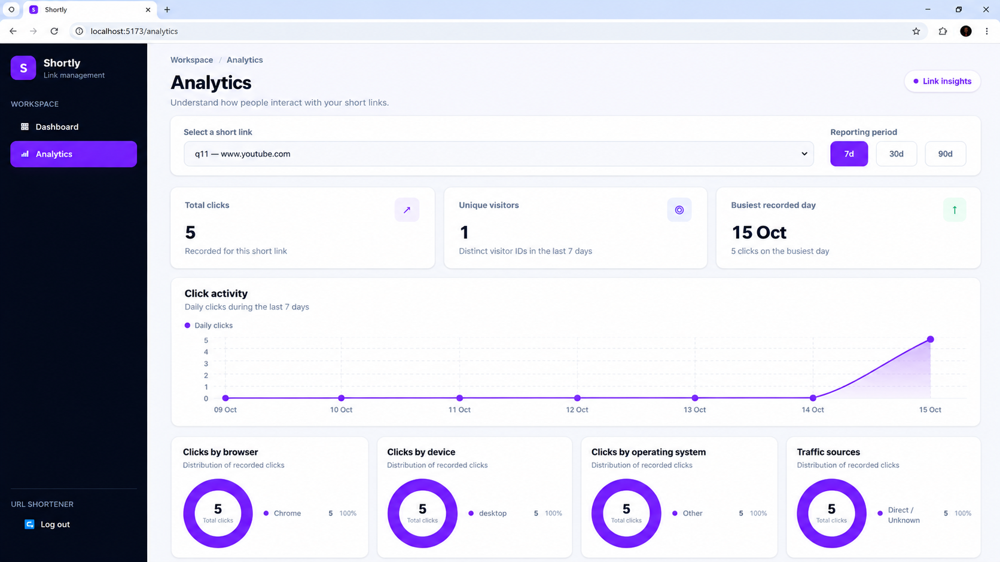
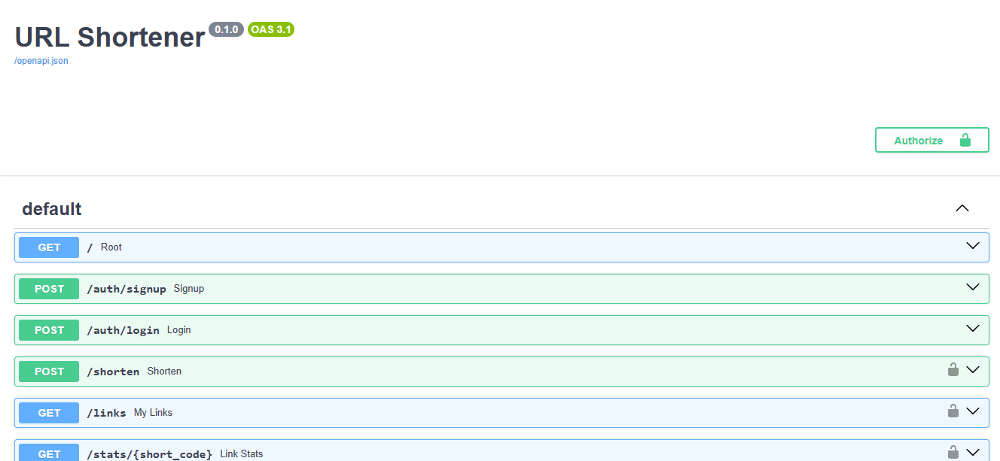

# Shortly — URL Shortener & Analytics

A full-stack URL shortener built with **FastAPI, React, PostgreSQL, and Redis**. Shortly lets users create and manage short links, track click activity, and explore link performance through an analytics dashboard.


## 🚀 Live Demo

- **Frontend:** [Try the URL Shortener](https://tasleem-url-shortener-frontend.onrender.com)
- **Backend API Documentation:** [Explore the API with Swagger](https://url-shortener-n5z1.onrender.com/docs)


## Screenshots

### Login



### Dashboard



### Analytics



### API Documentation



## Features

- **URL shortening:** Generate compact Base62 short codes for long URLs.
- **User authentication:** Sign up and log in using JWT-based authentication.
- **Link management:** View, search, copy, and delete your short links.
- **Click tracking:** Record clicks when users visit shortened URLs.
- **Analytics dashboard:** Explore click activity over selectable reporting periods.
- **Unique visitors:** Estimate unique visitors using anonymous browser cookies.
- **Traffic breakdowns:** View analytics by browser, device, operating system, and referrer.
- **Redis caching:** Cache frequently accessed short-link lookups.
- **Batched click writes:** Queue click events in Redis and insert them into PostgreSQL in batches.
- **Rate limiting:** Use Redis-backed rate limits to help control excessive requests.
- **API documentation:** Explore endpoints through FastAPI's interactive Swagger UI.

## Tech Stack

| Layer | Technologies |
|---|---|
| Frontend | React, Vite, Tailwind CSS |
| Backend | Python, FastAPI |
| Database | PostgreSQL, Neon |
| ORM | SQLAlchemy |
| Caching and queue | Redis, Upstash Redis |
| Authentication | JWT, bcrypt |
| Testing | Pytest |
| API documentation | Swagger UI / OpenAPI |
| Version control | Git, GitHub |

## How It Works

1. A user signs up or logs in to access the application.
2. The frontend sends authenticated requests to the FastAPI backend.
3. The backend validates requests and creates short links stored in PostgreSQL.
4. When someone visits a short URL, the backend resolves the code and redirects them to the destination.
5. Click events are queued in Redis and written to PostgreSQL in batches.
6. The analytics API aggregates recorded events and returns statistics for the frontend dashboard.

## Project Structure

```text
url-shortener/
├── app/
│   ├── main.py
│   ├── models.py
│   ├── schemas.py
│   ├── database.py
│   ├── config.py
│   ├── cache.py
│   ├── analytics.py
│   └── utils.py
├── frontend/
│   ├── src/
│   │   ├── api.js
│   │   ├── App.jsx
│   │   ├── AuthContext.jsx
│   │   └── ...
│   ├── package.json
│   └── ...
├── screenshots/
│   ├── login.png
│   ├── dashboard.png
│   ├── analytics.png
│   └── api-docs.png
├── requirements.txt
├── requirements-dev.txt
├── package.json
├── package-lock.json
└── README.md
```

## Getting Started

### Prerequisites

Install or configure the following:

- Python 3.11 or another version supported by your dependencies
- Node.js and npm
- PostgreSQL database
- Redis-compatible service

This project uses Neon for PostgreSQL and Upstash for Redis in its configured cloud setup. You can use compatible local services if your configuration supports them.

### 1. Clone the repository

```bash
git clone https://github.com/tasleembeleri8-oss/url-shortener.git
cd url-shortener
```

### 2. Configure environment variables

Create a `.env` file in the project root and configure the variables expected by `app/config.py`.

Your configuration needs to provide the database connection, Redis connection, JWT/authentication settings, and any application URL settings used by the project.

**Important:** Check `app/config.py` for the exact environment variable names and required values. Do not commit `.env` or expose credentials in GitHub.

### 3. Set up the backend

Create and activate a virtual environment.

**Windows PowerShell:**

```powershell
python -m venv .venv
.\.venv\Scripts\Activate.ps1
```

Install the dependencies:

```powershell
pip install -r requirements.txt
```

Start the FastAPI server from the repository root:

```powershell
uvicorn app.main:app --host 127.0.0.1 --port 8000 --reload
```

The backend should be available at:

- API base URL: `http://127.0.0.1:8000`
- Interactive API documentation: `http://127.0.0.1:8000/docs`

### 4. Set up the frontend

Open a second terminal:

```powershell
cd frontend
npm install
npm run dev
```

Open the local frontend URL printed by Vite, usually:

`http://localhost:5173`

Make sure the frontend API configuration points to your running backend and that the backend's CORS settings permit the frontend origin.

## API Endpoints

The following endpoints are implemented in the application.

| Method | Endpoint | Purpose |
|---|---|---|
| `POST` | `/auth/signup` | Register a user |
| `POST` | `/auth/login` | Authenticate and obtain a token |
| `POST` | `/shorten` | Create a short link |
| `GET` | `/links` | Retrieve the user's links |
| `GET` | `/stats/{code}?days=7` | Retrieve link analytics |
| `DELETE` | `/links/{code}` | Delete a short link |
| `GET` | `/{code}` | Resolve and redirect a short URL |

Protected endpoints require the appropriate authentication token. Refer to `/docs` for request schemas, response formats, and authentication details.

## Analytics

The analytics dashboard provides:

- Total recorded clicks
- Estimated unique visitors
- Daily click activity
- Busiest recorded day
- Browser distribution
- Device distribution
- Operating-system distribution
- Traffic-source breakdown

The reporting-period selector supports 7-day, 30-day, and 90-day views for the relevant analytics.

### Analytics Notes

- Unique visitors are estimated using an anonymous browser cookie. Different browsers or devices can count the same person separately.
- Referrer information depends on what the visiting browser or application supplies. Some visits appear as `Direct / Unknown`.
- Older click records may not contain visitor IDs or operating-system information.
- Click events are written in batches, so analytics can lag behind recent redirects. Events still waiting in the queue may be lost if the queue or application fails before they are persisted.

## Engineering Decisions

### Redis caching

Frequently accessed short-link lookups can be served from Redis, reducing repeated database lookups.

### Batched click writes

Click events are queued in Redis and inserted into PostgreSQL in batches rather than requiring a separate database write for every redirect.

This reduces per-click database write overhead, with a trade-off: analytics may not reflect the latest clicks immediately, and queued events require appropriate failure handling.

### Rate limiting

Redis-backed rate limiting helps control excessive requests. A fixed-window strategy is straightforward to implement, although requests near window boundaries can allow bursts.

## Running Tests

Install the development dependencies:

```bash
pip install -r requirements-dev.txt
```

Run the test suite:

```bash
pytest
```

## Future Improvements

- Add database migrations with Alembic.
- Improve queued-event durability and retry handling.
- Evaluate sliding-window rate limiting.
- Add link expiration and additional link-management options.
- Expand automated integration and end-to-end tests.
- Add deployment configuration and a hosted demo.

## Author

**Tasleem Bel eri**

- GitHub: [@tasleembeleri8-oss](https://github.com/tasleembeleri8-oss)


